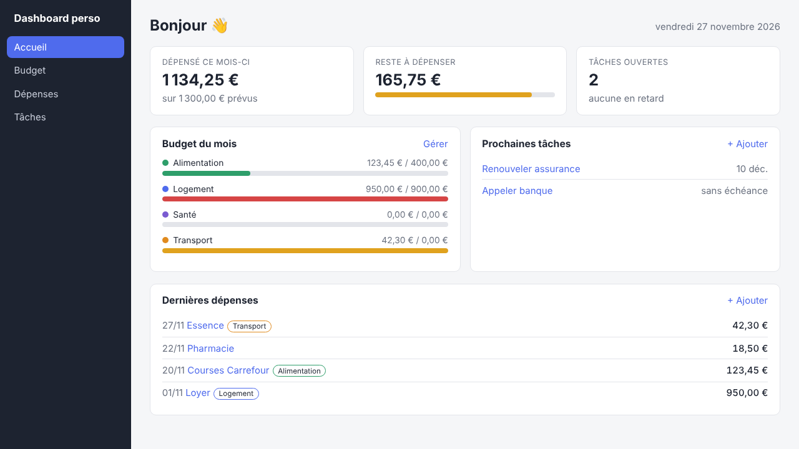
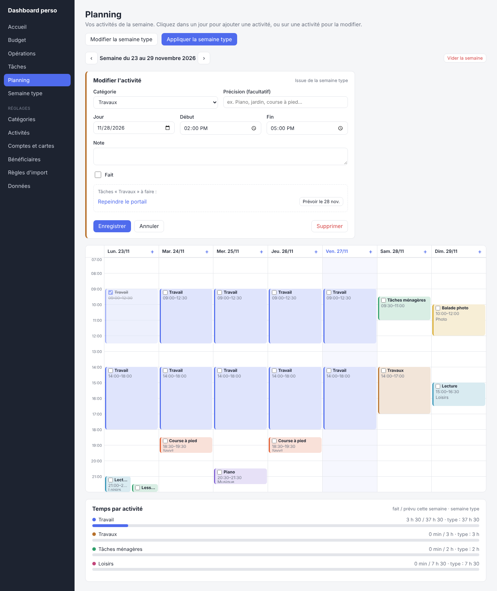
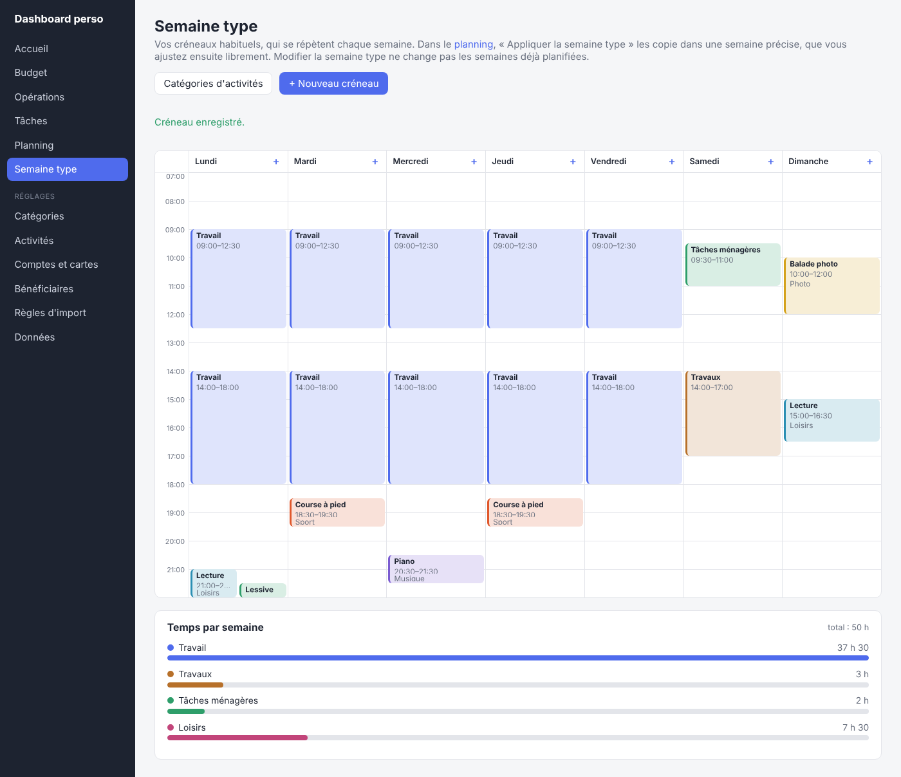

# Dashboard perso

Application personnelle qui centralise **budget**, **dépenses** et **tâches**. Elle tourne entièrement en local sur le Mac : un petit serveur web .NET et une base SQLite, sans cloud ni compte.

- **Stack** : .NET 10 (LTS), ASP.NET Core + Blazor (rendu interactif côté serveur), Entity Framework Core + SQLite.
- **Grilles** : `QuickGrid` (gratuit, fourni par Microsoft). Le code est organisé pour pouvoir passer à Telerik UI for Blazor plus tard (voir plus bas).



## Lancer l'application sur macOS

### 1. Installer le SDK .NET 10 (une seule fois)

Au choix :

- Installateur officiel : https://dotnet.microsoft.com/download/dotnet/10.0 (prendre **macOS Arm64** pour un Mac Apple Silicon M1/M2/M3/M4, **x64** pour un Mac Intel) ;
- ou avec Homebrew : `brew install --cask dotnet-sdk`

Vérifier dans le Terminal :

```bash
dotnet --version   # doit afficher 10.0.x
```

### 2. Démarrer

```bash
cd chemin/vers/dashboard-perso/src/DashboardPerso
dotnet run
```

Le navigateur s'ouvre sur **http://localhost:5090**. Pour arrêter : `Ctrl + C` dans le Terminal.

`dotnet run` lance la version de **développement** : port **5090** et base séparée `dashboard-dev.db` (réglages dans `appsettings.Development.json`). Elle peut tourner en même temps que la version installée (port 5080, étape 3) sans toucher à vos vraies données.

Au premier lancement, la base est créée automatiquement avec cinq catégories de budget (Logement, Alimentation, Transport, Loisirs, Santé) à 0 €. Dans **Budget**, vous pouvez les renommer, les supprimer, ajouter des sous-catégories et saisir les montants **annuels**.

Pour le développement, `dotnet watch` recharge l'application à chaque modification de fichier.

### 3. Installer l'application pour qu'elle tourne en permanence (recommandé)

Plutôt que de lancer `dotnet run` à chaque fois, installez une version autonome qui démarre toute seule à l'ouverture de session et tourne en arrière-plan :

```bash
cd chemin/vers/CentralDashboard
scripts/macos/installer.sh
```

Le script :

1. publie l'application en version Release autonome pour votre processeur (Apple Silicon `osx-arm64`, ou Intel `osx-x64`, détecté automatiquement) dans `~/Applications/DashboardPerso` ;
2. ajoute un lancement automatique à l'ouverture de session (`~/Library/LaunchAgents/local.dashboardperso.plist`), relancé s'il s'arrête ;
3. démarre l'application et ouvre **http://localhost:5080**.

Ensuite, il suffit d'ouvrir http://localhost:5080 (pensez à le mettre en favori).

| Action | Commande |
|---|---|
| Mettre à jour (git pull, republication, redémarrage) | `scripts/macos/mettre-a-jour.sh` |
| Réinstaller / redémarrer avec le code actuel | `scripts/macos/installer.sh` |
| Désinstaller (les données sont conservées) | `scripts/macos/desinstaller.sh` |
| Arrêter jusqu'à la prochaine session | `launchctl bootout gui/$(id -u)/local.dashboardperso` |
| Comprendre pourquoi l'app ne tourne pas | `scripts/macos/diagnostic.sh` |
| Journaux | `~/Library/Logs/DashboardPerso/` |

**Sources NuGet :** le fichier `nuget.config` à la racine du dépôt limite la restauration à nuget.org et ignore les sources configurées globalement sur le Mac (par exemple le flux Telerik d'un autre projet). Sans lui, `dotnet publish` échoue avec « Impossible de charger l'index de service pour la source https://nuget.telerik.com/v3/index.json » si ce flux n'est pas authentifié.

**Si l'app ne démarre pas après un redémarrage :** macOS demande d'autoriser les éléments lancés en arrière-plan. Ouvrez Réglages Système › Général › Ouverture, section « Autoriser en arrière-plan », vérifiez que DashboardPerso (ou l'élément sans nom de développeur) est activé, puis relancez `scripts/macos/installer.sh`. `scripts/macos/diagnostic.sh` indique l'état du lancement automatique et les dernières erreurs.

Vos données restent dans `~/Library/Application Support/DashboardPerso/` : installer, mettre à jour ou désinstaller n'y touche pas, et les migrations s'appliquent au redémarrage. La version installée utilise le port 5080 et `dashboard.db` ; `dotnet run` utilise le port 5090 et `dashboard-dev.db` : les deux peuvent tourner en même temps.

## Où sont mes données ?

Dans un seul fichier SQLite :

```
~/Library/Application Support/DashboardPerso/dashboard.db
```

La version de développement (`dotnet run`) utilise une autre base, dans le même dossier : `dashboard-dev.db`. Pour repartir de zéro en développement, supprimez ce fichier ; pour essayer sur une copie de vos vraies données, copiez `dashboard.db` en `dashboard-dev.db`.

Le chemin exact est affiché dans le Terminal au démarrage (`Environnement : … · base de données : …`). Il est en dehors du dossier du code : supprimer ou recloner le projet ne touche pas aux données.

- **Sauvegarde** : copier ce fichier (application arrêtée), ou laisser Time Machine s'en charger.
- **Changer d'emplacement** (ex. un dossier iCloud Drive) : renseigner `Database:Path` dans `src/DashboardPerso/appsettings.json`.
- **Consulter la base** : n'importe quel outil SQLite (DB Browser for SQLite, `sqlite3`, l'extension SQLite de VS Code…).

## Ce que fait le squelette

| Page | Contenu |
|---|---|
| **Accueil** (`/`) | Dépensé ce mois-ci vs prévu, reste à dépenser, tâches ouvertes et en retard, budget par catégorie, prochaines tâches, dernières dépenses. |
| **Budget** (`/budget`) | Catégories et sous-catégories (ex. Automobile › Carburant, Assurance, Entretien), budget **annuel**, vue par mois (annuel ÷ 12) ou par année (avec le prévu à date). |
| **Opérations** (`/depenses`) | Dépenses et recettes. Liste par mois ou par année (bouton Mois / Année, ou `/depenses?vue=annee`), une vue par provenance (compte, chaque carte), filtre par catégorie, transferts affichables ou masqués, tri, pagination, total. Ajout, modification, suppression. La liste garde sa vue, sa période, ses filtres et sa page au retour d'une fiche. |
| **Import** (`/depenses/import`) | Import du relevé CSV du Crédit Agricole : aperçu, catégories proposées par des règles, doublons écartés. |
| **Tâches** (`/taches`) | **Aujourd'hui** et **Demain** : choisir les tâches à faire dans la journée (« + Aujourd'hui », « + Demain », ajout rapide), les cocher au fil de la journée, reporter à demain celles qui ne sont pas faites (une tâche non faite reste aussi dans la liste du jour, marquée « Reportée »). Les tâches du jour s'affichent et se cochent sur l'accueil. Filtres par statut, priorité, échéance (en rouge si dépassée), case à cocher pour terminer. Ajout, modification, suppression. |
| **Planning** (`/planning`, `/planning/semaine-type`) | Semaine type (créneaux habituels par jour et heure) et planning de chaque semaine, par catégorie d'activité (travail, travaux, ménage, loisirs…). Voir « Planning d'activités ». |

## Catégories et budget

- **Budget annuel** : les montants saisis sont annuels. En vue « Mois », le prévu vaut budget annuel ÷ 12. En vue « Année », la colonne « Prévu à date » donne le budget au prorata des jours écoulés.
- **Sous-catégories** (un seul niveau) : lien **+ sous-catégorie** sur une catégorie principale. Le budget et les dépenses d'une catégorie principale cumulent ceux de ses sous-catégories. Une part « non répartie » est possible (budget ou dépenses affectés directement à la catégorie principale).
- **Dépenses et règles d'import** peuvent viser une catégorie principale ou une sous-catégorie. Filtrer les dépenses sur une catégorie principale inclut ses sous-catégories.
- **Réglages › Catégories** (`/categories`) : toutes les catégories de dépenses et de recettes, avec leur utilisation. « Renommer » directement dans la liste, « Supprimer » avec réaffectation des opérations, règles et bénéficiaires à une catégorie du même type, « Modifier » pour le budget, la couleur et la catégorie parente.
- **Supprimer une catégorie** : ses dépenses et ses règles peuvent être rattachées à une autre catégorie. Sinon, les dépenses restent sans catégorie et les règles sont supprimées. Une catégorie qui a des sous-catégories ne peut pas être supprimée tant qu'elle en a.

## Recettes

- **Catégories de recettes** : sur la page Budget, « + Catégorie de recettes » (ex. Salaire › Primes, Revenus locatifs, Remboursements santé). Le montant saisi est la recette **prévue sur l'année**. Une sous-catégorie prend le type de sa catégorie principale. Le type d'une catégorie ne peut plus changer une fois qu'elle a des opérations.
- **Budget** : la page affiche les recettes (prévu, encaissé, écart) au-dessus des dépenses, ainsi que le solde recettes − dépenses, réel et prévu. En vue « Année », le tableau **Recettes mois par mois** permet de suivre les revenus variables, avec la moyenne sur les mois écoulés.
- **Saisie et import** : une recette ne propose que des catégories de recettes, une dépense que des catégories de dépenses. Les règles d'import et la catégorie par défaut d'un bénéficiaire s'appliquent aussi aux recettes, selon le type de la catégorie visée. Une recette peut être ventilée.
- **Remboursements** : un crédit peut aussi être classé dans une **catégorie de dépenses** (remboursement CPAM ou mutuelle en Santé, avoir d'un magasin…). Il est alors déduit du dépensé de cette catégorie au lieu de compter en recettes, et marqué « Remboursement » dans la liste. Une règle d'import ou la catégorie par défaut d'un bénéficiaire (ex. MAAF Santé → Santé) peut le classer automatiquement. Une dépense, elle, ne peut pas aller dans une catégorie de recettes.
- Les transferts (ex. virement depuis l'épargne) ne comptent ni en recettes ni en dépenses.

> Mise à jour depuis une version précédente : les anciens budgets mensuels sont automatiquement multipliés par 12 au premier lancement.

## Comptes, cartes et bénéficiaires

- **Comptes et cartes** (`/comptes`) : chaque compte ou carte présent dans un relevé est créé à l'import. Son libellé est modifiable et il est conservé aux imports suivants. Pour une **carte sans relevé téléchargeable** (ex. carte de crédit), ajoutez-la ici puis saisissez ses dépenses à la main : le bouton « + Nouvelle dépense » de son onglet la présélectionne.
- **Bénéficiaires** (`/beneficiaires`) : ils sont déduits du libellé bancaire à l'import (« ORANGE SA-ORANGE - Orange - Votre abonnement… » → « ORANGE SA-ORANGE »), ou saisis sur une dépense. On peut les renommer : le lien avec le libellé bancaire est conservé.
- **Catégorie par défaut** d'un bénéficiaire (ou « Transfert ») : elle s'applique aux nouvelles dépenses, à l'import comme à la saisie, avant les règles d'import. « Appliquer » catégorise aussi ses dépenses existantes sans catégorie.

## Ventilation et solde

- **Ventiler une dépense** : sur la fiche d'une dépense, « Ventiler sur plusieurs catégories » permet de répartir le montant en plusieurs parts. Leur somme doit égaler le montant, et chaque part compte dans le budget de sa catégorie.
- **Recettes** : le choix Dépense / Recette se fait en haut de la fiche. Les recettes s'affichent en vert avec un « + » dans la liste. Voir la section Recettes pour leur suivi dans le budget.
- **Solde théorique** : dans **Comptes et cartes**, saisissez le solde du compte courant à une date (fin de journée). Le solde théorique = ce solde + recettes − dépenses et transferts du compte courant postérieurs. Il est comparé au solde indiqué par la banque dans le dernier relevé importé, et affiché sur l'accueil. Un écart signale en général des opérations manquantes.

## Effacer les opérations importées

**Réglages › Données** (`/donnees`) efface les opérations venues d'un relevé, pour toutes les opérations ou pour un compte / une carte et/ou une période. Un aperçu indique le nombre et les montants concernés, et il faut taper « EFFACER » pour confirmer. Catégories, budgets, règles, bénéficiaires, comptes, solde initial et saisies manuelles sont conservés. Les opérations effacées peuvent ensuite être réimportées.

## Importer un relevé bancaire (Crédit Agricole)

1. Sur le site du Crédit Agricole, téléchargez la liste des opérations du compte au format **CSV**.
2. Dans l'application : **Dépenses → Importer un relevé**, puis choisissez le fichier.
3. Un aperçu s'affiche : vous pouvez décocher des lignes, corriger un libellé ou une catégorie. Rien n'est enregistré avant de cliquer sur **Importer**.

Ce qui est importé :

- **Les débits** deviennent des dépenses, **les crédits** (salaire, remboursements…) des **recettes** : hors budget et hors totaux de dépenses, mais comptées dans le solde. Le solde indiqué par la banque (« Solde au … ») est mémorisé.
- **Les paiements par carte** (cartes à débit différé, sections « carte » en fin de fichier) sont importés un par un, avec la carte d'origine (« Carte ••5524 · … »). Ils sont datés du jour du paiement.
- **Le débit mensuel de la carte** sur le compte est reconnu (libellé mentionnant la carte et montant égal au total de la section carte). Il est importé comme **transfert** : visible, sans catégorie, hors budget. Ainsi les paiements ne sont pas comptés deux fois.
- **Transferts** : une règle peut aussi marquer un libellé comme transfert, par exemple un virement vers un compte de crédit. On peut également cocher « Transfert » sur une dépense.
- **Doublons** : chaque opération importée garde une empreinte (date, montant, libellé complet). Réimporter un fichier qui chevauche le précédent n'ajoute que les nouvelles opérations. Si une dépense saisie à la main a la même date et le même montant, la ligne est marquée « doublon possible » et décochée.
- **Catégories** : la catégorie par défaut du bénéficiaire est appliquée en premier. Sinon, la page **Règles de catégorie** associe un texte (ex. `ORANGE SA`) à une catégorie. Les majuscules et les accents ne comptent pas, et la règle la plus longue l'emporte. Le lien **+ règle** de l'aperçu crée une règle à partir d'une ligne et l'applique aussitôt aux autres.

Le libellé bancaire complet est conservé dans les notes de chaque dépense importée.

## Planning d'activités

- **Réglages › Activités** : catégories d'activités modifiables (nom, couleur, sous-catégories). Au départ : Travail, Travaux, Tâches ménagères, Loisirs › Sport, Musique, Lecture, Photo.
- **Semaine type** : vos créneaux habituels (jour, heure de début et de fin, catégorie, précision facultative comme « Piano »). Un créneau peut être créé d'un coup pour plusieurs jours (lundi → vendredi, week-end…). Le temps prévu par catégorie s'affiche sous la grille.
- **Planning** : la semaine réelle. « Appliquer la semaine type » y copie les créneaux habituels (sans doublon si on recommence), qu'on ajuste ensuite : déplacer, supprimer, ajouter une activité ponctuelle, cocher ce qui est fait. Modifier la semaine type ne change pas les semaines déjà planifiées. En bas : temps fait / prévu par catégorie, comparé à la semaine type.
- **Lien avec les tâches** : une tâche peut avoir un type d'activité (ex. « Repeindre le portail » → Travaux). En ouvrant un créneau Travaux du planning, les tâches Travaux à faire sont proposées, avec un bouton pour les prévoir ce jour-là.
- **Accueil** : la carte « Au programme aujourd'hui » liste les activités du jour, à cocher, avec les tâches correspondantes à caser.





## Tests

```bash
dotnet test
```

Les tests utilisent un relevé **fictif** (`tests/DashboardPerso.Tests/Fixtures/ca-anonymise.csv`). Ne mettez jamais un vrai relevé dans le dépôt.

## Organisation du code

```
dashboard-perso/
├── DashboardPerso.slnx            Solution (ouvrable dans Rider, VS Code, Visual Studio)
├── dotnet-tools.json              Outil dotnet-ef pour les migrations
└── src/DashboardPerso/
    ├── Program.cs                 Démarrage : culture fr-FR, SQLite, migrations auto
    ├── Models/                    BudgetCategory, Expense, TaskItem
    ├── Data/AppDbContext.cs       Contexte EF Core
    ├── Data/Migrations/           Schéma de la base, versionné
    ├── Services/                  Accès aux données (BudgetService, ExpenseService, TaskService)
    ├── Services/Import/           Lecture du CSV bancaire, doublons, règles de catégorie
    ├── Components/Pages/          Accueil, Budget/, Depenses/, Taches/
    ├── Components/Shared/         Sélecteur de mois, barre de progression, pagination, bouton supprimer
    └── wwwroot/app.css            Styles (thème clair / sombre automatique selon macOS)
tests/DashboardPerso.Tests/        Tests xUnit (lecture CSV, doublons, règles)
```

Les pages ne parlent jamais directement à la base : elles appellent les services, qui renvoient de simples `List<T>`.

## Faire évoluer le modèle de données

Après avoir modifié une classe de `Models/` :

```bash
cd dashboard-perso
dotnet tool restore                                   # une seule fois
cd src/DashboardPerso
dotnet ef migrations add NomDeLaModification -o Data/Migrations
dotnet run                                            # la migration est appliquée au démarrage
```

## Passer à Telerik UI for Blazor (plus tard)

Les services renvoient des `List<T>`, ce qui correspond directement au paramètre `Data` du `TelerikGrid`. Pour migrer une page :

1. Ajouter le paquet `Telerik.UI.for.Blazor` (flux NuGet Telerik, licence requise), après avoir ajouté la source `https://nuget.telerik.com/v3/index.json` dans le `nuget.config` du dépôt (identifiants hors du dépôt), et suivre leur guide d'installation (`AddTelerikBlazor()`, `<TelerikRootComponent>` dans `MainLayout.razor`, CSS du thème).
2. Remplacer le `<QuickGrid Items="...">` de la page par un `<TelerikGrid Data="@items">` avec ses `<GridColumn>`. Les services et les modèles ne changent pas.

Chaque grille est signalée par un commentaire dans le code (`TelerikGrid`).
